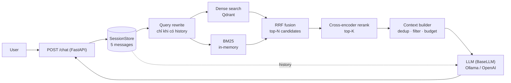

# RAG Chatbot — Hybrid Retrieval + Reranking

Chatbot hỏi đáp trên một knowledge base có sẵn (dự án kiến trúc – nội thất, tin tức, thông tin công ty), hội thoại nhiều lượt, chạy hoàn toàn local bằng Ollama và dễ dàng đổi sang API LLM khác.

- **Hybrid retrieval thật**: Dense (Qdrant, multilingual-e5) + BM25 (inverted index) hợp nhất bằng **RRF**.
- **Cross-encoder reranker** đa ngôn ngữ (`bge-reranker-v2-m3`).
- **LLM abstraction**: đổi `LLM__PROVIDER` (ollama/openai) mà không sửa RAG pipeline.
- **Session memory** 5 message gần nhất, **query rewriting** cho câu hỏi nối tiếp.
- FastAPI, Docker Compose, pytest, evaluation (Recall@5/MRR + LLM-judge), log latency theo từng bước.
- Frontend React (Vite + TypeScript + Tailwind).

## Kiến trúc



### Chat flow (một lượt)

| # | Bước | Ghi chú |
|---|------|---------|
| 1 | Validate request | `message` 1–500 ký tự, `session_id` `[A-Za-z0-9_-]{1,64}` |
| 2 | Lấy history của session | tối đa 5 message gần nhất |
| 3 | **Query rewrite** | Chỉ khi có history: LLM viết lại thành câu độc lập; lỗi thì dùng câu gốc |
| 4 | Hybrid retrieval | Retrieval dùng **câu đã rewrite**, không đưa history thô vào retriever |
| 5 | Rerank | Top-N (20) → top-K (5) |
| 6 | Context construction | Dedup → lọc theo điểm rerank → giữ thứ tự → cắt theo ngân sách ký tự |
| 7 | LLM | Gọi **chỉ khi còn context**; prompt = system + history + context + **câu hỏi gốc** |
| 8 | Cập nhật memory | **Sau khi** LLM trả lời thành công |

Nếu không còn chunk nào đủ liên quan, hệ thống trả câu "không tìm thấy thông tin" và **không gọi LLM** (tránh bịa).

### Vì sao thiết kế như vậy

- **Hybrid + RRF**: dense hiểu ngữ nghĩa nhưng yếu với tên riêng/số liệu; BM25 ngược lại. Hai nhánh tìm độc lập trên toàn corpus rồi gộp theo *rank* (RRF) nên không phải chuẩn hóa điểm cosine với điểm BM25 (khác thang đo).
- **Reranker**: retriever (bi-encoder) nhanh nhưng thô; cross-encoder chấm từng cặp (query, chunk) chính xác hơn nhưng tốn O(N) lượt forward → chỉ chạy trên N=20 ứng viên, giữ K=5 cho LLM. N lớn hơn → recall cao hơn nhưng latency tăng tuyến tính.
- **Memory in-memory**: demo/local một process, không cần Redis/Postgres. Có TTL (30 phút) và giới hạn số session. Đổi sang Redis chỉ cần thay `SessionStore` (cùng 3 method `get/append/delete`).
- **Chỉ tạo interface ở nơi có ≥2 implementation**: `BaseLLM` (Ollama, OpenAI), `BaseReranker` (cross-encoder, passthrough). Các thành phần còn lại là lớp cụ thể, được inject qua constructor vào `RAGPipeline` nên test được bằng fake.

## Cấu trúc thư mục

```
api/          app.py (lifespan, CORS), bootstrap.py (wiring), deps.py, errors.py, schemas.py, routes/
core/         config.py (pydantic-settings), errors.py, schema.py, setup_logging.py
ingestion/    chunking/ (chunker theo từng loại dữ liệu), helpers/, load_data.py, pipeline.py
embedding/    embedder.py (E5: tự thêm "query: "/"passage: ")
vectorstore/  qdrant.py (collection, upsert, load_corpus)
retrieval/    dense.py, bm25_index.py, rrf.py, hybrid.py
reranking/    base.py, reranker.py, models/cross_encoder.py
rag/          pipeline.py, context.py, prompts.py, query_rewrite.py, timing.py
llm/          base.py, ollama.py, openai.py, factory.py
memory/       session.py
scripts/      ingest.py
evaluation/   dataset.json (42 câu), evaluate.py, metrics.py
tests/        unit/, integration/
frontend/     Vite + React + TypeScript
```

## Dữ liệu

Knowledge base là file `database_export_*.json`, không nằm trong git. Tải về từ [Google Drive](https://drive.google.com/file/d/13ihR34bYv4A4pkdpaUnbjJI9oPEBdnLz/view?usp=drive_link) và đặt vào `data/raw/` trước khi ingest.

## Chạy local (không Docker cho app)

Yêu cầu: Python 3.11+, Node 20+, [Ollama](https://ollama.com), Docker (cho Qdrant) *hoặc* dùng Qdrant embedded.

```bash
python -m venv .venv && source .venv/bin/activate        # Windows: .venv\Scripts\activate
pip install -r requirements-dev.txt
cp .env.example .env

docker compose up -d qdrant                               # hoặc đặt QDRANT__PATH=./qdrant_local trong .env (không cần Docker)
ollama pull qwen2.5:3b

# Đặt file database_export_*.json vào data/raw/ rồi ingest
python -m scripts.ingest                                  # thêm --recreate để xây lại collection

uvicorn api.app:app --reload                              # http://localhost:8000/docs

cd frontend && npm install && npm run dev                 # http://localhost:5173
```

Ingest **idempotent**: id của chunk là `uuid5(source, chunk_type, text)`, chạy lại không nhân đôi dữ liệu.

## Chạy bằng Docker Compose

```bash
cp .env.example .env
docker compose up -d qdrant ollama
docker compose exec ollama ollama pull qwen2.5:3b       # model lưu ở volume ollama_models
docker compose run --rm api python -m scripts.ingest     # cần data/raw/database_export_*.json
docker compose up -d --build
```

- UI: http://localhost:8080 · API: http://localhost:8000/docs
- Volume: `qdrant_data` (vector DB), `ollama_models` (model LLM), `hf_cache` (model embedding/reranker).
- Trong compose, `QDRANT__URL` và `LLM__BASE_URL` được trỏ tới tên service (`qdrant`, `ollama`).
- **GPU NVIDIA**: `docker compose -f docker-compose.yml -f docker-compose.gpu.yml up -d` (cần NVIDIA Container Toolkit; Windows: Docker Desktop + WSL2).

## Cấu hình

Mọi giá trị đặt trong `.env` (xem [.env.example](.env.example)); mặc định nằm ở [core/config.py](core/config.py). Cấu trúc lồng nhau dùng `__`, ví dụ `LLM__PROVIDER`, `RERANK__TOP_K`.

> **Migrate từ bản cũ:** `LLM_MODEL_NAME` → `LLM__MODEL`, `QDRANT_URL` → `QDRANT__URL`, `RERANKING_*` → `RERANK__*`, `EMBEDDING_MODEL` → `EMBEDDING__MODEL`. Biến cũ không còn được đọc.

### Đổi LLM provider

```env
# Ollama (mặc định)
LLM__PROVIDER=ollama
LLM__MODEL=qwen2.5:3b

# OpenAI
LLM__PROVIDER=openai
LLM__MODEL=gpt-4o-mini
LLM__API_KEY=sk-...
```

Thêm provider mới: tạo `llm/<name>.py` kế thừa `BaseLLM` (`generate`, `ping`; ném `LLMTimeout`/`LLMUnavailable`/`LLMError`) và thêm một dòng vào `PROVIDERS` trong [llm/factory.py](llm/factory.py). Pipeline không thay đổi.

## API

| Method | Path | Mô tả |
|---|---|---|
| POST | `/chat` | Gửi một message |
| DELETE | `/sessions/{session_id}` | Xóa memory của session (idempotent, 204) |
| GET | `/health` | 200 khi Qdrant + LLM sẵn sàng, 503 nếu không |

```jsonc
// POST /chat
{ "session_id": "abc123", "message": "Resort Hải Vân 2 ở đâu?" }   // session_id có thể bỏ trống → server tạo mới

// 200
{
  "session_id": "abc123",
  "answer": "...",
  "sources": [
    { "title": "Resort Hải Vân 2", "type": "project", "slug": "...", "image_url": "...", "snippet": "...", "score": 0.93 }
  ]
}
```

Lỗi luôn có dạng `{"error": "<code>", "message": "<tiếng Việt thân thiện>"}`, không lộ stack trace:

| Tình huống | HTTP | `error` |
|---|---|---|
| message rỗng / quá dài / session_id sai | 400 | `invalid_request` |
| Gửi quá nhanh (60 req/phút/IP) | 429 | `rate_limited` |
| Qdrant lỗi | 503 | `vector_store_unavailable` |
| Ollama/OpenAI không kết nối được | 503 | `llm_unavailable` |
| LLM timeout | 504 | `llm_timeout` |
| LLM trả lỗi | 502 | `llm_error` |
| Lỗi không lường trước | 500 | `internal_error` |

Mỗi request ghi một dòng log: `session, query, standalone query, số candidate, số chunk trong context, t_rewrite/t_retrieval/t_rerank/t_llm/t_total, token vào/ra, error`.

## Testing

```bash
pytest -q          # ~80 test, không cần Ollama/GPU/mạng
```

- **Unit**: chunking + id xác định, BM25, RRF (đối chiếu tay), session memory (cap 5, TTL, LRU), context, prompt, LLM factory + ánh xạ lỗi, query rewrite, pipeline (fake LLM/retriever), metrics.
- **Integration**: Qdrant in-memory (upsert, dense search, hybrid), FastAPI `/chat` với `TestClient` (200, 400, 429, 502/503/504, DELETE session, health).

## Evaluation

```bash
python -m evaluation.evaluate                      # retrieval: dense vs bm25 vs hybrid vs hybrid+rerank
python -m evaluation.evaluate --generate --judge-model qwen2.5:7b
```

Dataset: 42 câu ([evaluation/dataset.json](evaluation/dataset.json)) gồm factual, company, list, news, follow-up (có history) và out-of-scope. Câu liên quan được xác định bằng **metadata** (ví dụ `project_id`), không phụ thuộc id chunk nên vẫn đúng khi đổi cách chunking.

### Kết quả

Máy: RTX 3050 Ti 4 GB, embedding + reranker (fp16) chạy `cuda`, LLM `qwen2.5:3b` qua Ollama, judge `qwen2.5:7b`. Dataset 42 câu (38 câu có đáp án chứa chunk, 4 câu out-of-scope).

**Retrieval** (top-5):

| Chế độ | Recall@5 | MRR | Precision@5 |
|---|---|---|---|
| dense | 0.947 | 0.947 | 0.826 |
| bm25 | 0.921 | 0.842 | 0.742 |
| hybrid (dense + BM25 + RRF) | 0.947 | 0.917 | 0.811 |
| **hybrid + rerank** | **0.974** | **0.974** | 0.774 |

- BM25 yếu ở câu hỏi thông tin công ty (MRR 0.40); hybrid cải thiện (0.77) và rerank đưa lên 1.00.
- Rerank cải thiện nhóm follow-up (Recall@5 0.67 → 0.83).
- Hybrid **không** vượt dense trên Recall@5 và MRR thấp hơn dense một chút (0.917 so với 0.947). Dataset nhỏ và đã gần trần nên chênh lệch chưa đủ để kết luận.

**Generation** (judge LLM, thang 1–5, câu in-scope): correctness **4.78**, faithfulness **4.64**, không từ chối nhầm câu nào. Judge là model 7B nên chỉ mang tính tham khảo.

**Câu out-of-scope:** lần chạy đầu với `RERANK__MIN_SCORE=0` chỉ từ chối đúng 2/4 câu (model 3B trả lời "Thủ đô nước Pháp là Paris" bằng kiến thức ngoài context). Điểm rerank của câu ngoài phạm vi tối đa 0.0011, của chunk đúng tối thiểu 0.0714, nên đặt ngưỡng `RERANK__MIN_SCORE=0.01`. Sau đó cả 4 câu đều trả "không tìm thấy" mà không gọi LLM. Lưu ý ngưỡng được hiệu chỉnh trên chính dataset này và chỉ kiểm tra lại trên 4 câu out-of-scope không có history, nên cần dataset độc lập để xác nhận.

**Latency** (p50 / p95, ms): retrieval 21 / 289, rerank 190 / 600 (GPU), LLM 8702 / 20794, tổng 9033 / 21307. LLM chiếm gần như toàn bộ thời gian; con số LLM bị đẩy cao vì Ollama phải đổi qua lại giữa model trả lời và model chấm trên GPU 4 GB.

## Giới hạn

- BM25 nằm trong RAM, build lại khi khởi động (phù hợp quy mô ~10³ chunk; lớn hơn nên dùng sparse vector của Qdrant hoặc OpenSearch).
- Session in-memory: mất khi restart, không dùng chung giữa nhiều instance.
- Tokenizer BM25 tách theo từ/âm tiết, chưa dùng tách từ tiếng Việt.
- Query rewrite thêm một lượt gọi LLM cho câu hỏi nối tiếp (tăng latency).
- Không OCR, không upload tài liệu qua API (ingestion chạy riêng bằng script).
- Judge bằng LLM nhỏ chỉ mang tính tham khảo.

## Future work

OCR/PDF-DOCX parser, citation verification, Anthropic provider, streaming, Redis cho session đa instance, sparse vector native của Qdrant, tách từ tiếng Việt cho BM25.
